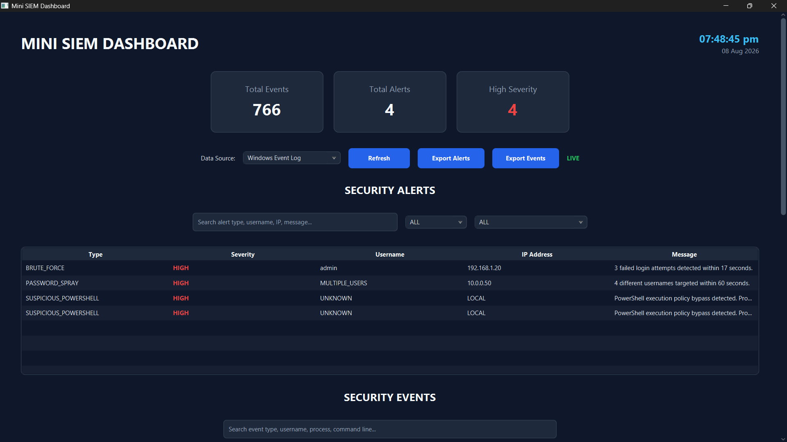
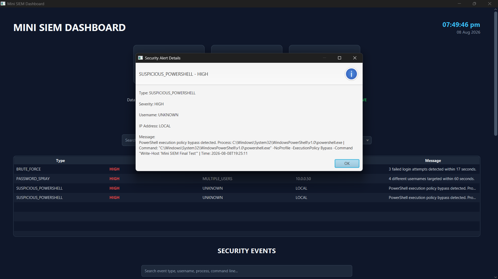

# 🛡️ Mini SIEM Dashboard

A lightweight **Security Information and Event Management (SIEM)** application built with **Java, JavaFX, SQLite, and Windows Event Logs**.

Mini SIEM collects Windows security events, stores them in a local database, analyzes them using detection rules, and displays security alerts through an interactive dashboard.

The project demonstrates fundamental concepts used by real-world SIEM platforms such as:

- Event collection
- Log parsing
- Security event monitoring
- Rule-based threat detection
- Alert generation
- Event persistence
- Security investigation
- Dashboard visualization

---

## 📸 Dashboard



---

## 🚨 Alert Investigation

Security alerts can be opened from the dashboard to view detailed information about the detected activity.



---

## ✨ Features

### 🖥️ Windows Event Log Monitoring

Mini SIEM can monitor Windows Event Logs and collect new security-related events while the application is running.

The dashboard displays a **LIVE** indicator when Windows monitoring is active.

---

### 🔍 Security Detection Engine

Collected events are analyzed by detection rules to identify suspicious behavior.

Current detections include:

| Detection | Description | Severity |
|---|---|---|
| `BRUTE_FORCE` | Detects repeated failed login attempts | HIGH |
| `PASSWORD_SPRAY` | Detects login attempts targeting multiple usernames | HIGH |
| `SUSPICIOUS_POWERSHELL` | Detects suspicious PowerShell execution patterns | HIGH |

The detection architecture can be extended with additional rules.

---

### 📊 Security Dashboard

The JavaFX dashboard provides an overview of the monitored system.

It displays:

- Total Events
- Total Alerts
- High Severity Alerts
- Live monitoring status
- Security Alerts
- Security Events
- Event analytics
- Alert analytics

---

### 🔎 Search and Filtering

Security analysts can search and filter events and alerts directly from the dashboard.

Alert filtering supports fields such as:

- Alert type
- Severity
- Username
- IP address
- Message

Event search supports fields such as:

- Event type
- Username
- Process
- Command line

---

### 🕵️ Alert Investigation

Alerts can be opened to inspect additional information including:

- Alert type
- Severity
- Username
- IP address
- Detection message
- Suspicious process information
- Command line
- Timestamp

This provides a simple investigation workflow similar to a basic SOC dashboard.

---

### 💾 SQLite Persistence

Mini SIEM uses **SQLite** to persist collected security information.

Stored data includes:

- Security events
- Security alerts

This allows data to remain available after the application is restarted.

---

### 📤 CSV Export

The dashboard provides:

- **Export Alerts**
- **Export Events**

This allows collected security information to be exported as CSV files for additional analysis or reporting.

---

### 🧪 Demo Mode

Mini SIEM also supports a demo log file.

The demo mode makes it possible to demonstrate detections without depending entirely on live Windows security events.

Example demo detections include:

```text
BRUTE_FORCE
PASSWORD_SPRAY
```

---

## 🏗️ Architecture

```text
             Windows Event Log
                     │
                     ▼
              Event Collector
                     │
                     ▼
                 Log Parser
                     │
                     ▼
              Security Events
                     │
          ┌──────────┴──────────┐
          ▼                     ▼
    SQLite Database      Detection Engine
                                │
                                ▼
                         Security Alerts
                                │
                                ▼
                         JavaFX Dashboard
                                │
                 ┌──────────────┴──────────────┐
                 ▼                             ▼
          Investigation                    CSV Export
```

---

## 📁 Project Structure

```text
mini-siem/
│
├── logs/
│   └── authentication.log
│
├── screenshots/
│   ├── dashboard.png
│   └── alert-details.png
│
├── src/
│   ├── main/
│   │   ├── java/
│   │   │   └── com/deepak/minisiem/
│   │   │       ├── alert/
│   │   │       ├── database/
│   │   │       ├── detector/
│   │   │       ├── engine/
│   │   │       ├── model/
│   │   │       ├── parser/
│   │   │       ├── reader/
│   │   │       ├── service/
│   │   │       ├── ui/
│   │   │       ├── util/
│   │   │       └── Main.java
│   │   │
│   │   └── resources/
│   │
│   └── test/
│
├── .gitignore
├── pom.xml
└── README.md
```

---

## 🛠️ Technologies Used

| Technology | Purpose |
|---|---|
| Java | Core application |
| JavaFX | Desktop dashboard GUI |
| SQLite | Local event and alert storage |
| JDBC | Java-to-SQLite communication |
| PowerShell | Windows Event Log collection |
| Maven | Dependency management and build |
| Git | Version control |

---

## ⚙️ Requirements

Before running the project, install:

- Java JDK
- Maven
- Git
- Windows operating system
- IntelliJ IDEA or another Java IDE

Because live event collection uses Windows Event Logs and PowerShell, the live monitoring functionality is intended for **Windows**.

---

## 🚀 Running the Project

### 1. Clone the repository

```bash
git clone <your-repository-url>
```

Move into the project:

```bash
cd mini-siem
```

### 2. Build the project

```bash
mvn clean compile
```

### 3. Run with Maven

```bash
mvn javafx:run
```

You can also open the project in IntelliJ IDEA and run:

```text
com.deepak.minisiem.Main
```

---

## 🧪 Example Detection

A suspicious PowerShell command can generate a `SUSPICIOUS_POWERSHELL` alert when it matches one of the configured detection patterns.

For example, the SIEM can identify suspicious PowerShell execution behavior involving execution-policy bypass techniques.

The resulting alert appears in the **Security Alerts** table where it can be opened for investigation.

> Use security testing commands only on systems you own or are authorized to test.

---

## 🔄 Application Workflow

```text
Start Mini SIEM
      │
      ▼
Initialize SQLite
      │
      ▼
Load Dashboard
      │
      ▼
Start Windows Event Monitoring
      │
      ▼
Collect New Events
      │
      ▼
Parse Events
      │
      ▼
Store Events in SQLite
      │
      ▼
Run Detection Rules
      │
      ▼
Generate Alerts
      │
      ▼
Display Alerts on Dashboard
      │
      ▼
Search / Filter / Investigate / Export
```

---

## 🎯 Project Goals

This project was created to understand how a basic SIEM works internally.

The main learning objectives include:

- Understanding Windows security events
- Collecting and parsing security logs
- Building rule-based detection logic
- Detecting suspicious authentication activity
- Detecting suspicious process activity
- Persisting events using SQLite
- Creating a security monitoring dashboard
- Building an alert investigation workflow

---

## 🔮 Future Improvements

Possible future additions include:

- More Windows Event ID detections
- MITRE ATT&CK technique mapping
- Alert risk scoring
- Alert status such as Open / Investigating / Resolved
- Event timeline visualization
- Additional analytics charts
- Configurable detection rules
- Network event monitoring
- File integrity monitoring
- Improved false-positive suppression
- Automated testing
- Packaged Windows executable

---

## ⚠️ Disclaimer

This project is intended for **educational and defensive cybersecurity purposes**.

Use monitoring and security-testing functionality only on systems that you own or have explicit authorization to analyze.

---

## 👨‍💻 Author

**Deepak**

Cybersecurity & Java Project

---

## ⭐ Support

If you find this project useful, consider giving the repository a ⭐ on GitHub.